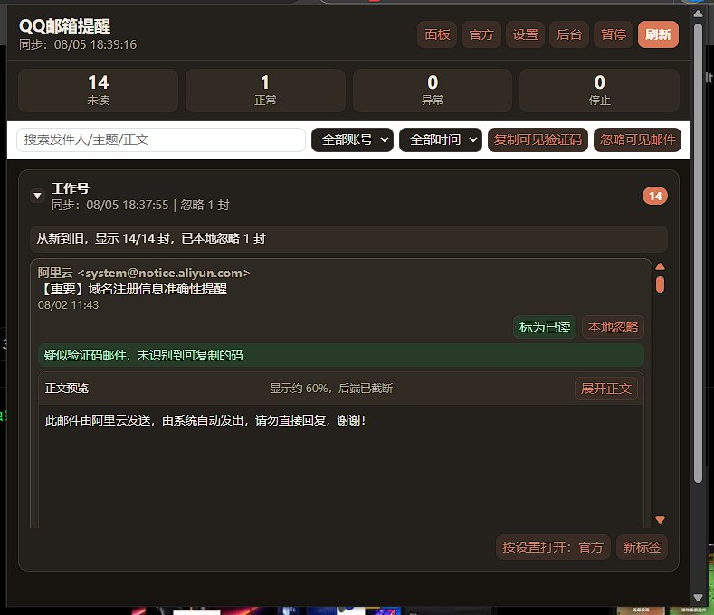
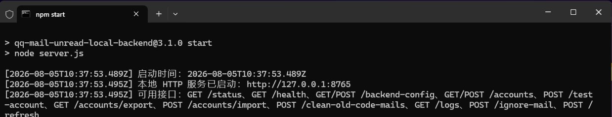

<div align="center">


**QQ邮箱多账号未读提醒 - 本地后端 + Chrome扩展**

[](https://github.com/momoqiqi-qwq/qq-mail-unread/stargazers) 

</div>

<details open>
<summary><b>目录</b></summary>

- [✨ 项目简介](#-项目简介)
- [🎨 主要特点](#-主要特点)
- [📦 包含模块](#-包含模块)
- [🛠️ 如何使用](#️-如何使用)
- [❓ 效果演示](#-效果演示)
- [🙏 贡献](#-贡献)

</details>

---

---

---

---

---

# 📬 QQ 邮箱多账号未读提醒

### ✨ 项目简介

一个**本地运行**的 QQ 邮箱多账号未读监控方案：本地 Node.js 后端通过 **IMAP** 轮询多个 QQ 邮箱的未读邮件，**Chrome 扩展**（Manifest V3）在浏览器工具栏显示未读徽章、弹窗与通知，并支持**验证码快速复制**。全程不经过任何第三方服务器——后端只监听 `127.0.0.1`，QQ 邮箱授权码只保存在本机。当前版本 **v3.1**。

### 🎨 主要特点

- 👥 **多账号**：同时监控多个 QQ 邮箱，独立开关与轮询配置
- 📡 **IMAP 本地轮询**：不经第三方，授权码是 IMAP/SMTP 授权码而非 QQ 密码
- 🔢 **验证码快取**：未读邮件中的验证码一键复制，旧验证码一键清理
- 🔔 **多形态提醒**：扩展图标徽章、弹窗列表、系统通知、标为已读、本地忽略、搜索筛选
- 🖥️ **管理后台**：账号管理、轮询状态概览、备份恢复、工具箱
- 🎨 **11 套主题**：扩展与后台统一换肤

### 📦 包含模块

1. **本地后端**（`backend/`）—— Node.js 服务：IMAP 查询、账号管理 GUI、状态接口
2. **Chrome 扩展**（`chrome-extension/`）—— MV3：徽章、弹窗、通知，从本地后端读取状态
3. **截图与文档**（`picture/`、`OPTIMIZATION_NOTES*.md`）—— 界面预览与各版本优化记录

### 🛠️ 如何使用

1. 启动本地后端：

   ```bash
   cd backend
   npm install
   npm start
   ```

2. 在后端管理后台添加 QQ 邮箱账号（使用 QQ 邮箱设置里生成的 **IMAP/SMTP 授权码**）
3. Chrome 打开 `chrome://extensions` → 开发者模式 → 「加载已解压的扩展程序」→ 选择 `chrome-extension/`
4. 固定扩展图标，未读数量会以徽章实时显示，点开弹窗即可查看与复制验证码

### ❓ 效果演示

| 🧩 Chrome 扩展弹窗 | 🖥️ 后端管理后台 | 🔔 扩展图标 |
|---|---|---|
|  |  |  |

多账号未读列表、验证码快速复制、账号管理与轮询状态概览、工具栏未读徽章。

### 🙏 贡献

欢迎 Issue 与 PR：更多邮箱协议（IMAP 通用化）、提醒策略、主题都值得扩展。安全相关改动请优先保证「数据不出本机」这一原则。

> 本 README 按照 [App-Showcase-Template](https://github.com/yxs2003/App-Showcase-Template) 的展示流程编写。
